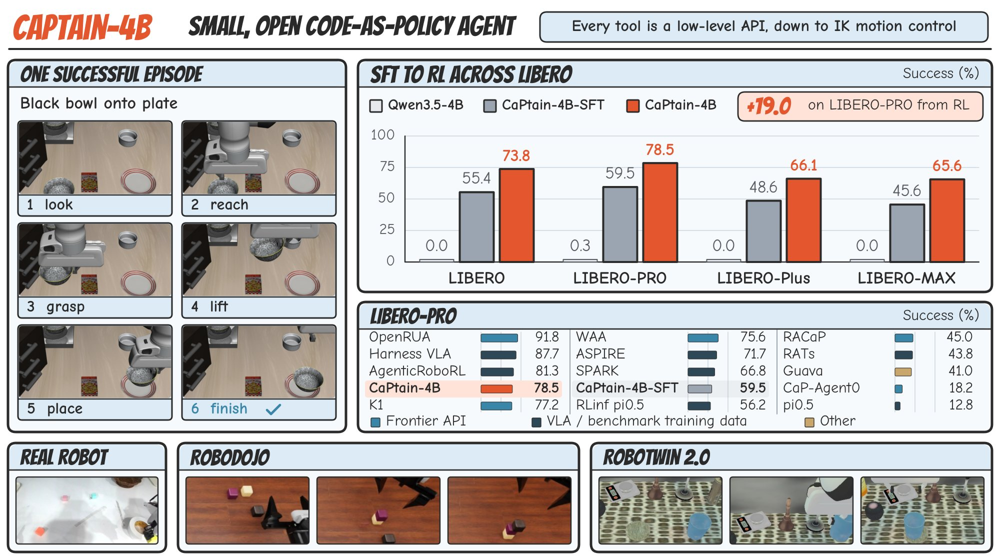
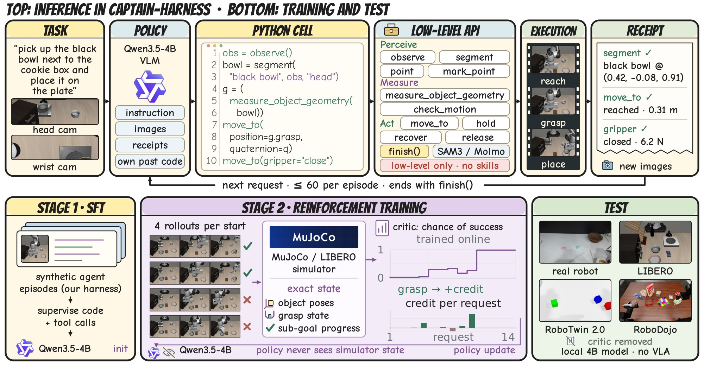
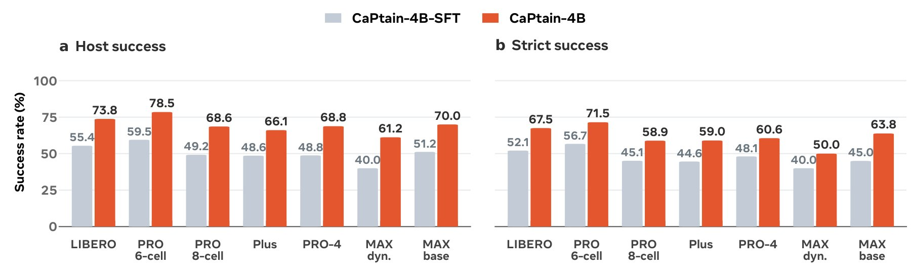

<div align="center">

# CaPtain: A Pipeline for Post-Training Code-as-Policy Robot Agents

**The first fully open, all-stage pipeline for a small, pure code-as-policy model**

[](#)
[](#)
[](#)
[](LICENSE)



</div>

## What is CaPtain

CaPtain post-trains a small open vision-language model into a **code-as-policy (CaP) robot agent**: the agent controls a
robot by writing Python against low-level perception and motion primitives, reads the receipts of its own robot calls,
and decides itself when the task is done. Everything needed to reproduce and use it is open:

- **CaPtain-Harness** — a persistent, sandboxed Python session with 22 low-level capabilities (perception, geometric
  measurement, IK-level motion) and `finish()`, no high-level skills and no VLA. Every call returns a text receipt. The
  same API runs on LIBERO, LIBERO-PRO / Plus / MAX, RoboTwin 2.0, RoboDojo, SimplerEnv, CaP-Bench and real robots.
  The harness lives in its own repository, [CaPtain-Harness](https://github.com/waltstephen/CaPtain-Harness), and is
  included here as a pinned git submodule at `harness/`.
- **The pipeline** — SFT on synthetic agent trajectories collected in the harness, then RL with a **simulator critic**: a
  small critic reads the simulator's physical state (object poses, grasp state, sub-goal progress) and turns the change
  in its predicted success across each model request into that request's credit. The policy never sees this state.
- **CaPtain-4B** — Qwen3.5-4B after SFT and RL. At test time it uses neither a frontier model nor a benchmark-trained VLA.
- **Open release** — SFT data, model weights, harness, SFT and RL training code, and the RL infrastructure
  (streaming rollout servers, critic co-training, run supervisor).

<div align="center">

</div>

## News

- **[2026/10]** 🔥 Code release: CaPtain-Harness with all benchmark backends, SFT and RL training code.
- **Coming soon** 🤗 CaPtain-4B, CaPtain-4B-SFT and the SFT data on Hugging Face · 📄 paper on arXiv.

## Results

**SFT → RL on the LIBERO family** (host / strict success %; strict additionally requires that the agent called `finish()` itself):

| Benchmark | Episodes | Qwen3.5-4B | CaPtain-4B-SFT | **CaPtain-4B** |
|---|:-:|:-:|:-:|:-:|
| LIBERO, official held-out states 11–16 | 240 | 0.0 / 0.0 | 55.4 / 52.1 | **73.8 / 67.5** |
| LIBERO-PRO Pos+Task, 6-cell mean | 600 | 0.3 / 0.2 | 59.5 / 56.7 | **78.5 / 71.5** |
| LIBERO-PRO Pos+Task, 8-cell mean | 800 | 0.2 / 0.1 | 49.2 / 45.1 | **68.6 / 58.9** |
| LIBERO-Plus, 7 categories | 700 | 0.0 / 0.0 | 48.6 / 44.6 | **66.1 / 59.0** |
| LIBERO-PRO, 4 categories | 160 | 0.0 / 0.0 | 48.8 / 48.1 | **68.8 / 60.6** |
| LIBERO-MAX Dynamic | 80 | 0.0 / 0.0 | 40.0 / 40.0 | **61.2 / 50.0** |
| LIBERO-MAX Base | 80 | 0.0 / 0.0 | 51.2 / 45.0 | **70.0 / 63.8** |

<div align="center"></div>

**LIBERO-PRO Pos+Task** (6-cell / 8-cell mean, %): CaPtain-4B reaches **78.5**, the best result we know of among systems
that use neither a frontier model nor a LIBERO-trained VLA at test time (the full comparison is in the paper).

**Zero-shot transfer** of CaPtain-4B, trained only on LIBERO:

| Benchmark | Protocol | CaPtain-4B | Reference points |
|---|---|:-:|---|
| RoboTwin 2.0 | official Hard protocol, 50 tasks × 100 trials | **22.6** (single-arm 30.0) | X-VLA 20.9, Xiaomi-Robotics-0 18.2, π0 16.3 (trained on RoboTwin demos) |
| SimplerEnv | WidowX (Bridge) visual matching, 4 tasks × 24 | **83.3** | ManiAgent (GPT-5) 86.8, PhysBrain 1.0 80.2, π0.5 57.1 |
| CaP-Bench | Cube Lift + Cube Stack at CaP-Gym's step horizon | **75.0** | CaP-X M2 (Gemini-3-Pro) 73.5, CaP-RL 62.0 |
| RoboDojo | 42 tasks, official layouts and action budget (leaderboard Score) | **1.7** | GPT-5.5 agent 1.1, RDT 0.5, OpenVLA-OFT 0.2 |

The transfer backends use inputs beyond the benchmarks' official policy observation (simulated depth, camera
calibration, a wrist force or contact signal, and on SimplerEnv an added wrist camera); they are listed per benchmark in
[`harness/eval/transfer/README.md`](harness/eval/transfer/README.md). The agent never receives object poses, the success
predicate or task progress.

## Installation

Linux x86_64 with NVIDIA GPUs (EGL for MuJoCo; Vulkan for the SAPIEN / Isaac Sim transfer benchmarks), `bubblewrap` ≥ 0.5.

| Route | Use it when you want to… |
|---|---|
| Harness only | evaluate CaPtain-4B (or your own model) in CaPtain-Harness, or plug in a new robot or benchmark |
| + transfer environments | run RoboTwin 2.0, RoboDojo or SimplerEnv ([`harness/eval/transfer/`](harness/eval/transfer/README.md)) |
| + training | reproduce SFT ([`sft/`](sft/README.md)) and RL ([`rl/`](rl/README.md)) |

The harness is a git submodule ([CaPtain-Harness](https://github.com/waltstephen/CaPtain-Harness), pinned to the commit
used for this release), so clone recursively. In an existing clone, run `git submodule update --init`.

```bash
git clone --recursive https://github.com/waltstephen/CaPtain.git && cd CaPtain/harness
scripts/setup_third_party.sh                                   # LIBERO @ pinned revision into third_party/
python3.10 -m venv .venv-libero && .venv-libero/bin/pip install -r requirements-libero.txt \
  && .venv-libero/bin/pip install -e third_party/libero --no-deps && .venv-libero/bin/pip install -e . --no-deps
python3.11 -m venv ~/envs/student-py311 && ~/envs/student-py311/bin/pip install -r requirements-student.txt   # the agent's sandboxed Python
python3.11 -m venv .venv-transfer && .venv-transfer/bin/pip install -r requirements-transfer.txt              # only for RoboTwin / RoboDojo / SimplerEnv
```

Model weights (SAM 3, Molmo2-8B, CaPtain-4B): `harness/scripts/download_models.sh`. Perception services, the policy server
(vLLM 0.29) and per-benchmark simulator installs are described in [`harness/INSTALL.md`](harness/INSTALL.md).

## Quick Start

**1. Evaluate CaPtain-4B on one LIBERO episode**

```bash
cd harness
services/start_perception.sh                                    # SAM 3 :8114 + Molmo2-8B :8122
services/serve_policy.sh <hf-user>/CaPtain-4B 8600              # vLLM 0.29, OpenAI-compatible endpoint
STUDENT_PYTHON=~/envs/student-py311/bin/python eval/run_episode.sh libero_spatial 0 11 runs/demo
cat runs/demo/libero_spatial_0_seed-11/episode_result.json      # host_final_success, agent_finished, termination_reason, ...
```

Any OpenAI-compatible endpoint works (`POLICY_URL`, default `http://127.0.0.1:8600/v1`; `--auth bearer` reads
`CAPTAIN_API_KEY` or `OPENAI_API_KEY`), so the harness can also run frontier models or your own checkpoints.

**2. Reproduce the paper's evaluations**

```bash
export POLICY_URL=http://127.0.0.1:8600/v1 STUDENT_PYTHON=~/envs/student-py311/bin/python EGL_DEVICE=0
python3 eval/run_jobs.py eval/tasks/libero_official_240.tsv --out runs/captain-4b --parallel 8
python3 eval/summarize.py eval/tasks/libero_official_240.tsv runs/captain-4b
```

The other task lists (LIBERO-PRO, LIBERO-Plus, LIBERO-MAX) are in [`harness/docs/harness.md`](harness/docs/harness.md); the transfer
benchmarks in [`harness/eval/transfer/README.md`](harness/eval/transfer/README.md).

**3. Train**

- SFT (2 × 8 GPUs): [`sft/README.md`](sft/README.md) — data format, the two stages and `train/launch_sft.sh`.
- RL (16 GPUs: 8 trainer + 8 rollout; an 8-GPU config is included): [`rl/README.md`](rl/README.md) —
  `bash rl/scripts/run_stream.sh rl/configs/captain-4b.json` starts perception, policy servers, the environment server and
  the trainer under one supervisor.

## Repository layout

| Path | What it is |
|---|---|
| [`harness/`](harness/README.md) | **CaPtain-Harness** (git submodule, pinned; [repository](https://github.com/waltstephen/CaPtain-Harness)): the `python` tool, the 22-capability robot API, receipts, completion gate, context compaction, perception services, all backends, evaluation runners, task lists and scorers |
| [`harness/eval/transfer/`](harness/eval/transfer/README.md) | zero-shot transfer: install notes, official protocol settings, task lists, run and scoring scripts per benchmark |
| [`sft/`](sft/README.md) | SFT for CaPtain-4B-SFT: data format, trainer (DeepSpeed ZeRO-3), launch script, exact configuration |
| [`rl/`](rl/README.md) | RL for CaPtain-4B: streaming rollout and environment servers, the simulator critic, advantages, SAO-style update, trainer, run supervisor, final-run configuration |
| [`docs/`](docs) | figures used in this README |

## For AI agents

> 🤖 Most people now hand a repository to a coding agent. This section is written for that agent: paste it, or point
> your agent at [`AGENTS.md`](AGENTS.md), which holds the same rules in more detail.

- **Entry points.** Run one episode: `harness/eval/run_episode.sh <suite> <task_id> <seed> <out_dir>`. Run a task list:
  `harness/eval/run_jobs.py <tasks.tsv> --out <dir>`. Score: `harness/eval/summarize.py`. Train: `sft/train/launch_sft.sh`,
  `rl/scripts/run_stream.sh <config>`.
- **Where things live.** Robot API, receipts and capability contracts: `harness/src/captain_harness/adapters/` and `ports/`. One episode:
  `harness/src/captain_harness/server/`. ReAct loop, compaction, model client: `harness/src/captain_harness/react/`.
  Backends: `adapters/{libero,robotwin2,robodojo,simplerenv,capgym,hardware}`. RL critic and advantages: `rl/`.
- **Invariants you must keep.**
  1. `react` must not import `server` or `adapters` and must not use robot or task vocabulary (`tests/test_import_boundaries.py`).
  2. Hidden state stays hidden: nothing served to the model carries poses, contacts or the success predicate; the episode
     output directory is hidden from the sandbox.
  3. Budgets (request cap, wall time, action budget) are enforced in the server, not the driver.
  4. Do not change model-visible text (TASK.md, tool descriptions, receipts, request template) when evaluating the
     released checkpoints; they were trained on exactly this text.
- **Adding a robot or benchmark.** Implement a backend under `adapters/` with the same capability manifest, register its
  suite, add a task list under `eval/`, and run `pytest tests/test_transfer_wiring.py`. For real hardware implement the
  driver protocol in `adapters/hardware` (measured state, one control tick, hold, camera frames with depth and intrinsics).
- **Checks before you finish.** `cd harness && .venv-libero/bin/python -m pytest -q tests/test_react_*.py
  tests/test_server_env_server.py tests/test_import_boundaries.py tests/test_transfer_wiring.py` (seconds, CPU).
- **Configuration.** Machine paths come from environment variables (`POLICY_URL`, `STUDENT_PYTHON`, `EGL_DEVICE`,
  `CAPTAIN_ROOT`, `CAPTAIN_WORKSPACE`, …); never hard-code paths or keys.

## Hardware used for the paper

| Stage | Hardware | Time |
|---|---|---|
| SFT (stage 2) | 16 × H100-80GB | ~7.6 h (~120 GPU-hours) |
| RL (CaPtain-4B, 300 rounds of 256 episodes) | 16 × H100-80GB: 8 trainer; 8 rollout (6 vLLM policies, SAM 3, Molmo2-8B, EGL rendering) | ~1,290 GPU-hours |
| Evaluation | 1 GPU for the policy plus 1 for perception and rendering | ~6 min median per LIBERO episode |

## License

The code is released under the [MIT License](LICENSE). Third-party components keep their own licenses; see
[THIRD_PARTY_LICENSES.md](THIRD_PARTY_LICENSES.md) (SAM 3 weights fall under the SAM License). Model weights follow the
license of the base model, Qwen3.5-4B (Apache-2.0). Known limitations of this release: [RELEASE_NOTES.md](RELEASE_NOTES.md).

## Citation

```bibtex
@article{fan2026captain,
  title   = {CaPtain: A Pipeline for Post-Training Code-as-Policy Robot Agents},
  author  = {Fan, Yijia and He, Xilin and Jiang, Yilei and Wu, Dongming and Wang, Jiaxu and Yue, Xiangyu},
  journal = {arXiv preprint},
  year    = {2026}
}
```

## Contact

Questions and issues: open a GitHub issue, or contact the corresponding author, Xiangyu Yue (xyyue@ie.cuhk.edu.hk).
